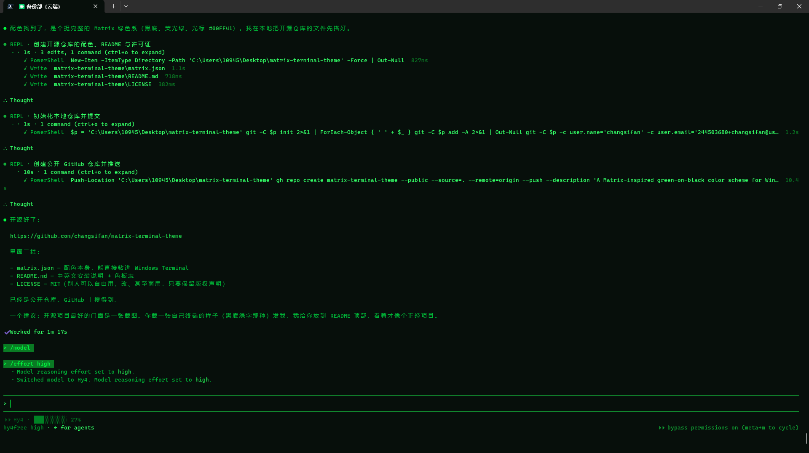

# Matrix Terminal Theme

A green-on-black color scheme inspired by *The Matrix*, built for **Windows Terminal**.

Dark background, phosphor-green text, neon cursor.

## Preview



```text
$ whoami
neo

$ echo "Wake up, Neo..."
Wake up, Neo...

$ ./follow-the-white-rabbit
```

## Install

1. Open Windows Terminal → **Settings** (`Ctrl + ,`)
2. Click **Open JSON file** (bottom-left corner)
3. Paste the contents of [`matrix.json`](./matrix.json) into the top-level `schemes` array:

```json
"schemes": [
    { "name": "Matrix", ... }
]
```

4. Set it as your default color scheme:

```json
"profiles": {
    "defaults": {
        "colorScheme": "Matrix"
    }
}
```

5. Save. The terminal restarts with the new colors.

## Palette

| Role      | Hex       |
|-----------|-----------|
| Background | `#070F0B` |
| Foreground | `#00B838` |
| Cursor     | `#00FF41` |
| Selection  | `#003300` |
| Black      | `#000000` |
| Red        | `#00701E` |
| Green      | `#008224` |
| Yellow     | `#00942A` |
| Blue       | `#00A630` |
| Purple     | `#00B836` |
| Cyan       | `#00CA3C` |
| White      | `#00FF41` |

## 中文说明

给 Windows Terminal 用的《黑客帝国》风格终端配色：黑底、荧光绿字、绿色光标。

安装：把 `matrix.json` 里的内容加到 settings.json 的 `schemes` 数组里，再把 `profiles.defaults.colorScheme` 设成 `"Matrix"`。

## License

MIT — see [LICENSE](./LICENSE).
